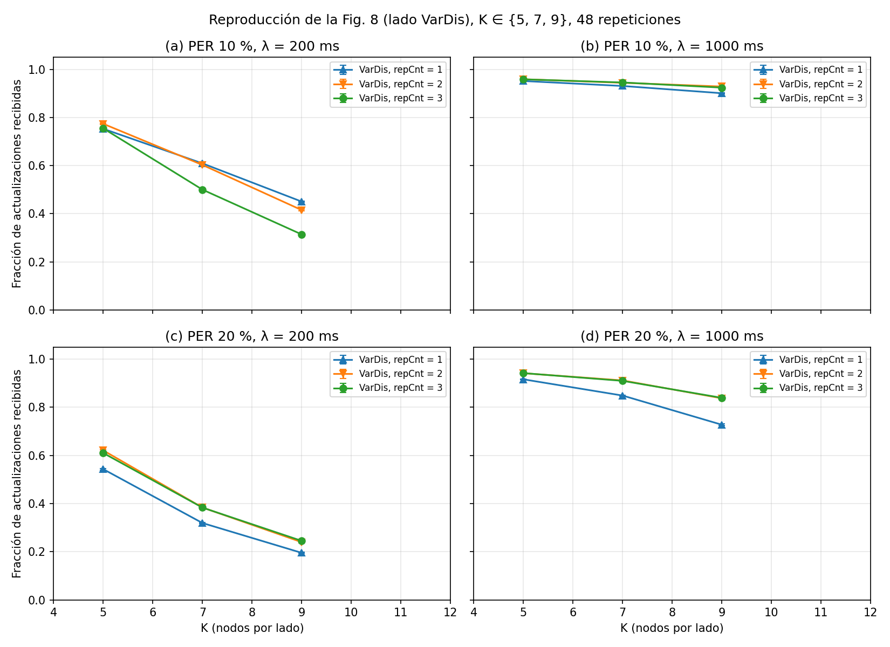

# Reproducción de la Fig. 8 de Pell y Willig (2025): VarDis en cuadrículas de densidad fija

Autor: Natalia Perez Buendia

Este repositorio documenta la reproducción parcial de los resultados de VarDis de la Fig. 8 de:

> S. Pell, A. Willig. *DCP and VarDis: An ad-hoc protocol stack for dynamic swarms and formations of drones*. Computer Communications 231 (2025) 108021. https://doi.org/10.1016/j.comcom.2024.108021

El simulador es de los autores y se incluye como submódulo (`codigo-original/`), fijado en el commit `e75345b5c35c2ed7d5e71ffc4b8f2c9b89e55a88` de https://github.com/awillig/dcp-vardis. Se usó la carpeta `simulation-code-paper/`, que contiene el código del artículo. Todo lo demás en este repositorio es trabajo propio.

## Resultado



Fracción de actualizaciones del productor de referencia (esquina inferior derecha) recibidas por el consumidor de referencia (esquina superior izquierda). Barras de error: intervalo de confianza del 95 %. En los paneles (b) y (d) la curva de repCnt = 2 queda oculta tras la de repCnt = 3 por tener valores casi idénticos. Tabla completa: `resultados/fig8_vardis.csv`.

## Alcance

| Parámetro | Artículo (Fig. 8) | Esta reproducción |
|---|---|---|
| K (nodos por lado) | 5, 7, 9, 11 | 5, 7, 9 |
| PER por enlace | 10 %, 20 % (separación 255 m, 263 m) | igual |
| λ (periodo de actualización) | 200 ms, 1000 ms | igual |
| repCnt | 1, 2, 3 | igual |
| β (tasa de beacons) | 20 Hz | igual |
| maxSumCnt | 10 | igual |
| Repeticiones por escenario | 48 (según `omnetpp.ini`) | 48 |
| Protocolo de *flooding* | sí | no |

En total: 1728 simulaciones (36 escenarios × 48 repeticiones), configuración `SmallGrids` de `Experiment3`. Se omitieron K = 11 y el *flooding* por su costo computacional: K = 11 se estimó en unas 60 horas adicionales en la máquina usada.

## Entorno

- Windows 11 + WSL2 con Ubuntu 22.04 (gcc 11.4), 32 hilos.
- OMNeT++ 6.0.3 e INET 4.4.2. Son las versiones que indica el artículo (OMNeT++ 6.0 e INET 4.4); el código de `simulation-code-paper` no funciona con INET 4.5.
- Ajustes necesarios al instalar OMNeT++ 6.0.3:
  - Instalar `pkg-config`.
  - Instalar `setuptools<81` en el entorno de Python (las versiones nuevas no incluyen `pkg_resources`).
  - En `configure.user`: `PREFER_CLANG=no`, `WITH_OSG=no`, `WITH_OSGEARTH=no`.

## Estructura

```
codigo-original/   código de Pell y Willig (submódulo, commit e75345b)
scripts/
  compilar.sh       genera los Makefiles (ausentes en el original) y compila
  vardis            ejecuta el simulador con las rutas NED correctas
  ejecutar_parte.sh selecciona las simulaciones de la Fig. 8 y las ejecuta en paralelo
  reanudar.sh       relanza las simulaciones que no terminaron
listas/             números de simulación de cada parte ejecutada
analisis/
  fig8.py           calcula la fracción recibida e IC 95 % a partir de los .sca
  plot_fig8.py      genera la gráfica de cuatro paneles
resultados/
  fig8_vardis.csv        resultados por escenario
  fig8_reproduccion.png  gráfica
  sca_crudos.tar.gz      los 1728 archivos .sca originales
```

## Cómo reproducir

1. Clonar con el submódulo:
   `git clone --recurse-submodules <url-de-este-repositorio>`
2. Instalar OMNeT++ 6.0.3 e INET 4.4.2 (ver Entorno) y cargar sus `setenv`.
3. Compilar: `scripts/compilar.sh <ruta>/codigo-original/simulation-code-paper`
4. Copiar `scripts/vardis` a una carpeta del `PATH` y ajustar en él la variable `P` a la ruta de `simulation-code-paper`.
5. Desde `simulation-code-paper/srp_vardis/simulations/Experiment3`, ejecutar cada parte:

   | Parte | Comando | Simulaciones | Tiempo real |
   |---|---|---|---|
   | 1 | `ejecutar_parte.sh 5 ambos parte1.txt` | 576 | 2 h 09 min |
   | 2 | `ejecutar_parte.sh 7 ambos parte2.txt` | 576 | 7 h 08 min |
   | 3a | `ejecutar_parte.sh 9 200 parte3a.txt` | 288 | 3 h 36 min |
   | 3b | `ejecutar_parte.sh 9 1000 parte3b.txt` | 288 | interrumpida; las 168 restantes tomaron 11 h 25 min |

   La parte 3b se interrumpió por un reinicio de la máquina y se completó con `reanudar.sh parte3b.txt parte3b_faltan.txt`.
6. Analizar: copiar `analisis/*.py` a la carpeta `Experiment3` y ejecutar `python3 fig8.py` y luego `python3 plot_fig8.py` (requiere matplotlib).

Para analizar sin simular, extraer `resultados/sca_crudos.tar.gz` (crea la carpeta `results/`) junto a los scripts de `analisis/` y ejecutarlos ahí.

## Métrica

La aplicación de `Experiment3` registra estadísticas solo para la variable del último nodo (productor de referencia), y guarda histogramas en tres nodos, entre ellos el nodo 0 (consumidor de referencia, en la esquina opuesta). Para cada escenario se suman las 48 repeticiones del histograma `seqnoDeltaHist` del nodo 0:

fracción recibida = Σ count / Σ sum

es decir, actualizaciones recibidas entre la suma de los saltos de número de secuencia. Esto mide la fracción entre la primera y la última actualización recibidas, no sobre todas las generadas; con 48 repeticiones largas la diferencia es despreciable. El IC 95 % se calcula sobre la fracción de cada repetición.

## Hallazgos sobre la reproducibilidad

1. **Faltan archivos de compilación y ejecución.** El repositorio original no incluye Makefiles ni los scripts `run` que menciona su readme. El readme también nombra una carpeta `srp_rddp` que se llama `srp_vardis`.
2. **El script de análisis del autor no corresponde a la Fig. 8.** `extract_data.py` calcula retardo y gap promediados entre nodos, no la fracción de actualizaciones recibidas. Además:
   - combina desviaciones estándar con `avg1 + avg2` donde la fórmula correcta usa `avg1 - avg2`;
   - para el nodo central usa el índice de la lista de tamaños (`n`) en vez del tamaño de la cuadrícula.

   Por eso se escribió `analisis/fig8.py`.
3. **Tamaño de beacon.** `omnetpp.ini` usa `maxBeaconSize = 300B`, mientras que la Tabla 1 del artículo indica 200 B y la sección 5.2 no menciona otro valor.
4. **Orden entre repCnt = 1 y repCnt = 3.** El texto del artículo atribuye la ventaja de repCnt = 1 a las tasas de pérdida altas. En esta reproducción ocurre lo contrario: con PER 10 % y λ = 200 ms, repCnt = 1 supera a repCnt = 3 (0,45 frente a 0,31 en K = 9), y con PER 20 % es repCnt = 3 el que supera a repCnt = 1.
5. **Tamaño de la muestra.** El artículo indica al menos 100 000 actualizaciones recibidas por escenario. Con 48 repeticiones esa cifra no se alcanza en los escenarios con más pérdidas (por ejemplo, 19 365 en K = 9, PER 20 %, λ = 200 ms, repCnt = 1), aunque los intervalos de confianza siguen siendo estrechos (± 0,001 a ± 0,003).
6. **Costo computacional.** El tiempo por simulación crece más rápido que el número de nodos: pasar de K = 5 a K = 7 multiplicó el costo por 3,3, y de K = 7 a K = 9 por más de 3.

## Resultado general

En K ∈ {5, 7, 9} los niveles y las tendencias de VarDis coinciden con la Fig. 8: alta fracción recibida con λ = 1000 ms, fuerte degradación con λ = 200 ms al crecer la red, y repCnt = 2 siempre entre las mejores opciones.

## Licencia y créditos

El simulador (`codigo-original/`) es de S. Pell y A. Willig y conserva su licencia original (LGPL). Los scripts, el análisis y la documentación de este repositorio son trabajo propio.
